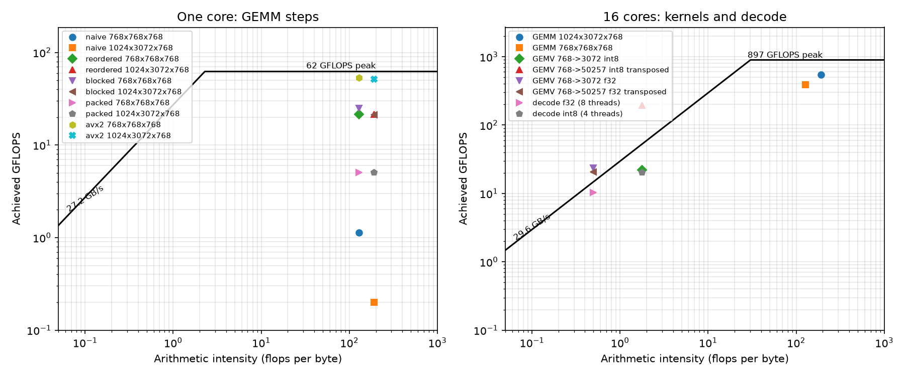
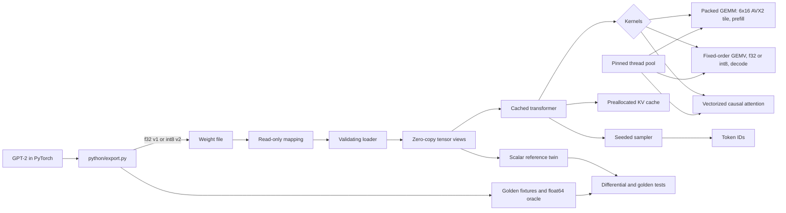

# nanoinfer

nanoinfer runs GPT-2 small (124M parameters) on a CPU with no ML framework at
run time: a C++20 loader memory-maps an exported weight file, and every
operation, from the GEMM micro-kernel to attention, sampling and the thread
pool, is written here. Python only exports weights, tokenizes and checks
results against PyTorch. The hard part is not running the model; it is making
the matrix products fast enough to approach the hardware limits while keeping
a numerical contract with PyTorch, and knowing exactly how far from those
limits each phase is. Prefill is compute-bound and decode is memory-bound, so
the project measures both against a roofline built from the machine's measured
peak and bandwidth, and uses int8 weights to cut the bytes decode has to read.

## Results

AMD Ryzen 9 8940HX (Zen 4, 16 cores), one DDR5-5200 channel, Windows 11 on AC
power with the Balanced plan, MSVC 19.44 `/O2 /arch:AVX2`. Medians of 5 to 7
runs; every number links to a JSON file in `results/` written by a script in
`bench/` or `scripts/`.

| Measurement | Result | Source |
|---|---|---|
| GEMM 1024x3072x768, one core: naive -> AVX2 6x16 micro-kernel | 0.20 -> 51.6 GFLOPS, 82.9% of the 62.3 GFLOPS single-core peak | [m4-gemm](results/m4-gemm.md) |
| GEMM 768x768x768, one core, AVX2 | 53.2 GFLOPS, 85.4% of peak | [m4-gemm](results/m4-gemm.md) |
| GEMM 1024x3072x768, 16 cores | 542 GFLOPS, 60% of the 897 GFLOPS all-core peak | [m7-kernels](results/m7-kernels.md) |
| Decode, 128 tokens after a 32-token prompt, int8 (4 threads) | 81.5 tok/s, 12.3 / 15.4 ms per token p50 / p99 | [m7-e2e](results/m7-e2e.json) |
| Decode, float32 (8 threads) | 41.9 tok/s, 23.0 / 83.6 ms p50 / p99 | [m7-e2e](results/m7-e2e.json) |
| PyTorch 2.11 CPU decode, float32, same prompt and thread counts | 16.1 tok/s at 4 threads, 16.9 at 8 (best) | [m7-e2e](results/m7-e2e.json) |
| Decode vs bandwidth ceiling (29.6 GB/s / weight bytes per token) | float32 70% of 59.9 tok/s; int8 38% of 212 tok/s | [m8-roofline](results/m8-roofline.json) |
| Prefill 128 / 512 tokens, 16 threads, float32 | runtime 526 / 809 tok/s; PyTorch 632 / 834 tok/s | [m7-e2e](results/m7-e2e.json) |
| WikiText-2 perplexity (16,384 tokens, window 1024, stride 512) | PyTorch f32 26.0162, runtime f32 26.0162, runtime int8 26.2467 (+0.23) | [m6-perplexity](results/m6-perplexity.md) |
| Logits vs PyTorch, three golden prompts | max abs error 1.8e-4; 32/32 greedy tokens | [m2-summary](results/m2-summary.json) |

At equal thread counts the int8 runtime decodes 5.1 times faster than PyTorch
(4 threads) and the float32 runtime 2.5 times faster (8 threads). PyTorch's
library GEMM wins prefill at 16 threads; the runtime is ahead at 8 threads
(553 vs 516 tok/s for 128 tokens). Full thread-scaling curves for all three
systems are in [m7.md](results/m7.md) and [m5.md](results/m5.md).



The left panel shows each GEMM step against one core's ceilings, the right
panel the threaded kernels and the fastest decode configurations against the
machine's. The compute ceiling is `cores x clock x 2 FMA pipes x 8 lanes x 2`
with the clock measured under FMA load on all cores (1.75 GHz here; 1.95 GHz on
one core), and the bandwidth ceiling is the measured read-only stream. GEMV
points above the DRAM line are shapes whose weights fit in the 64 MB L3 (the
9.4 MB MLP matrix, and the 43 MB int8 embedding). Decode sits below its
bandwidth line: each token runs about a hundred short parallel regions, and
synchronization dominates once the per-region work is small, which is also why
decode is fastest at 4 to 8 threads rather than 16.

## Architecture



`src/ops/ref` holds the scalar reference operations and `src/kernels` the
optimized ones; every optimized operation has a reference twin and a
differential test. [docs/kernels.md](docs/kernels.md) describes the GEMM steps,
[docs/quantization.md](docs/quantization.md) the int8 format and kernels,
[docs/runtime.md](docs/runtime.md) the cache and sampling contract, and
[docs/format.md](docs/format.md) the file format.

## Build and run

Requirements: CMake 3.20+, Ninja, Python 3.11+ and `uv`; on Linux GCC 12+ or
Clang 15+; on Windows Visual Studio 2022 Build Tools (C++ and AddressSanitizer).
GoogleTest and Google Benchmark are fetched by CMake.

```sh
uv sync --locked                     # add --group bench for the benchmark drivers
mkdir -p build
uv run python -m pytest --basetemp=build/pytest
cmake --preset debug && cmake --build --preset debug && ctest --preset debug
cmake --preset asan && cmake --build --preset asan && ctest --preset asan
```

On Windows, run `. .\scripts\dev-shell.ps1` first; it loads the x64 compiler
and the project venv. CTest builds a seeded tiny GPT-2, so the suite needs no
download.

Export the real model (f32 and int8) and generate text:

```sh
uv run python -m python.export --revision 607a30d783dfa663caf39e06633721c8d4cfcd7e --output models/gpt2.bin --golden golden
uv run python -m python.export --revision 607a30d783dfa663caf39e06633721c8d4cfcd7e --quant int8 --output models/gpt2-int8.bin
cmake --preset release -DNANOINFER_BENCHMARKS=ON && cmake --build --preset release
uv run python -m python.generate --executable build/release/gpt2rt --model models/gpt2-int8.bin --prompt "Hello" --max-new 32 --temp 0.8 --top-p 0.9 --seed 42
```

`gpt2rt` takes `--gemm` (auto, reference, naive, reordered, blocked, packed,
avx2) and `--threads` (default: one per physical core).

Reproduce every number in the results table:

```sh
uv run python bench/run_gemm.py      # results/m4-gemm.*      GEMM steps, one core
uv run python bench/run_m5.py        # results/m5-*           bandwidth, GEMV, scaling
uv run python bench/run_kernels.py   # results/m7-kernels.*   all-core peak, threaded GEMM
uv run python bench/run_m7.py        # results/m7-e2e.json    runtime vs PyTorch
uv run python -m python.perplexity --revision b08601e04326c79dfdd32d625aee71d232d685c3 --ids build/wikitext2-slice-ids.txt --report results/m6-perplexity-pytorch.json
uv run python scripts/perplexity_table.py                     # results/m6-perplexity.*
uv run python scripts/plot_roofline.py                        # docs/roofline.png
```

The benchmark drivers record CPU, memory, OS, compiler flags, power state and
background load with every result, and `run_m7.py` refuses to run on battery.

## Design decisions

- Chose a fixed 6 x 16 register tile over a larger AVX-512 one because Zen 4
  issues 512-bit FMAs as two 256-bit halves: twelve YMM accumulators already
  saturate both FMA pipes, and AVX2 runs on far more CPUs.
- Chose static partitioning with fixed work units over work stealing because
  every output tile and every GEMV block is then summed in the same order for
  any thread count. Results are bit-identical from 1 to 16 threads, which makes
  "golden outputs match with any thread count" a byte comparison.
- Chose a separate fixed-order GEMV for decode over reusing the GEMM because a
  one-row product is bandwidth-bound: packing would read the weights twice, and
  32-row partial sums stream them once while matching the int8 group size.
- Chose to dequantize int8 inside the inner loop over dequantizing to a buffer
  because the point of int8 is reading 1.125 bytes per weight instead of 4;
  prefill instead dequantizes while packing, so the GEMM micro-kernels are shared.
- Chose to judge optimized hidden states against a float64 oracle as well as
  PyTorch float32 because the blocked kernels proved 3 to 25 times more
  accurate than PyTorch's own float32 order; a bound tied to one float32
  summation order rejected the better result.
- Chose to keep AVX2 code in translation units with no shared inline functions
  because a linker keeps one copy of an inline function, and an AVX2-encoded
  copy would crash the scalar fallback on a CPU without AVX2.

## Testing

- **Differential tests:** every optimized kernel (five GEMM steps, threaded
  GEMM, f32 and int8 GEMV, int8 GEMM, attention) is compared with its scalar
  twin on random and awkward shapes (1, 7, 63, 65, 767, 769, tile and cache-block
  edges), with error measured relative to `sum |a||b|`. Seeds are printed and
  can be set with `--seed=N`.
- **Golden tests:** logits within 1e-3 of PyTorch, hidden states within the
  approved bound or no less accurate than PyTorch float32 against a float64
  oracle, and exactly 32 greedy tokens, for the scalar reference, every GEMM step
  and the cached runtime. CI uses a seeded tiny model; the pretrained check runs
  locally on three prompts.
- **Negative tests:** separately compiled variants with exact GELU or a wrong
  LayerNorm epsilon must fail the same golden comparison.
- **Equivalence and invariance:** cached decode equals full recomputation at
  every position, bit for bit; every runtime output is byte-identical across
  thread counts; C++ and PyTorch perplexity agree on the tiny model.
- **Malformed input:** every truncation length and every single-bit corruption
  of a model file, overflowing shapes, bad q8 groupings, scales and padding, and
  CLI argument errors, all through the native tools.
- **Sanitizers:** Debug, ASan and UBSan (fatal) on Linux and Windows, TSan on
  every threaded test, in CI. The local MSVC ASan runtime has a shutdown
  deadlock outside this code, documented with stacks in
  [docs/m3-asan-investigation.md](docs/m3-asan-investigation.md).

## Limitations

- GPT-2 small only, batch size one, single sequence per runtime instance.
- Prefill attention is vectorized but not blocked; at long prompts the logits
  for every position (a 50257-wide product) are part of the prefill cost.
- Decode does not reach the bandwidth ceiling: about a hundred short parallel
  regions per token leave synchronization overhead, and decode is fastest at
  fewer threads than cores on this machine.
- Benchmarks come from one laptop (single DDR5 channel, Windows Balanced power
  plan, turbo left on); absolute numbers move with power and thermal state.
- int8 is weight-only with per-group symmetric scales; activations stay float32.
- CRC32 detects accidental corruption, not tampering. Tokenization stays in
  Python (tiktoken).
