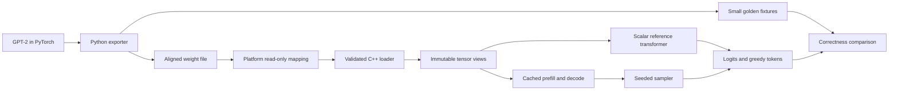

# nanoinfer

A C++20 CPU inference runtime for GPT-2 small, built one milestone at a time.
M3 adds a preallocated KV cache and seeded sampling to the scalar reference
forward pass and validated, read-only mapped loading. Later milestones add
hand-written GEMM and GEMV, a thread pool, and int8 weights. The main engineering
problem is keeping the numerical contract intact while changing how data moves
through the CPU.

M3 is blocked on the local ASan reliability gate. The owner stopped further
runtime-option trials; no workaround has been adopted. Captured stacks,
the M2 baseline and failed local controls are recorded in the
[investigation](docs/m3-asan-investigation.md).

M3 pretrained cached correctness results, identical in local Debug and ASan:

| Check across all three golden prompts | Measured result | Required |
|---|---:|---:|
| Maximum absolute logit error | 0.00018310546875 | < 0.001 |
| Maximum elementwise hidden error / allowed bound | 0.943782678711 | <= 1 |
| Exact greedy token agreement | 32/32 for each prompt | 32/32 |
| Cache/full-recompute logit and hidden error | 0 across 101 positions | Exact equality |

These values come from `scripts/summarize_m3.py` and
[the saved acceptance summary](results/m3-summary.json). The hidden bound is
the owner-approved `1e-4 + 1e-6 * abs(expected)`, applied independently to each
element. Maximum absolute hidden error is `0.00048828125`; it passes this
combined bound, not the original absolute-only `1e-4` bound.

No performance results have been collected yet. GEMM step measurements and the
roofline plot belong to M4 and M7-M8 and will link to actual runs in `results/`.



## Build and export

Requirements: Visual Studio 2022 C++ Build Tools with the Windows SDK, CMake/Ninja
and AddressSanitizer, Python 3.11 or newer, Git and `uv`. Linux requires GCC 12+
or Clang 15+, CMake 3.20+ and Ninja. Python dependencies are pinned in `uv.lock`;
GoogleTest and Google Benchmark are fetched by CMake, with benchmarks opt-in.

From the project directory in PowerShell:

```powershell
. .\scripts\dev-shell.ps1
uv sync --locked
New-Item -ItemType Directory -Force build | Out-Null
python -m pytest --basetemp=build/pytest -v
python -m python.export --tiny --output build/fixtures/tiny.bin --golden build/fixtures/golden
.\scripts\test-m3.ps1 -Preset debug
.\scripts\test-m3.ps1 -Preset asan
```

The development shell adds the native x64 compiler and project Python environment
to the current process's path. Caches and temporary files stay inside the project.
`scripts/test-m3.ps1` saves complete configure, build and test logs under `results/`.

For the recorded local validation, the venv reuses an existing PyTorch
`2.11.0+cu128` installation through `--system-site-packages`; every operation runs
on CPU. Other project dependencies are installed in the venv. This avoids a
stalled wheel download on this machine. To reproduce that setup with an existing
PyTorch 2.11 installation, create the venv with `uv venv --system-site-packages`
and use `uv sync --locked --no-install-package torch`. A fresh normal `uv sync`
and CI use the official CPU wheel. Exact local versions are in
`results/m1-environment.json`.
The Windows shell accepts Hugging Face's supported cache-copy fallback and
disables its symlink-privilege advisory; system privileges are not changed.

Equivalent Linux commands:

```sh
export UV_CACHE_DIR="$PWD/.cache/uv"
export HF_HOME="$PWD/.cache/huggingface"
export TIKTOKEN_CACHE_DIR="$PWD/.cache/tiktoken"
uv sync --locked
mkdir -p build
uv run python -m pytest --basetemp=build/pytest -v
uv run python -m python.export --tiny --output build/fixtures/tiny.bin --golden build/fixtures/golden
cmake --preset debug
cmake --build --preset debug
ctest --preset debug --verbose --no-tests=error
cmake --preset asan
cmake --build --preset asan
ctest --preset asan --verbose --no-tests=error
```

Export the real pretrained model:

```powershell
python -m python.export --output models/gpt2.bin --golden golden
```

The exporter prints and saves the tensor manifest beside the model. Full weights,
download caches and generated test weights are ignored by Git. Only the small
pretrained golden set is committed. Golden fixtures are correctness data, not a
replacement for the model download.

Inspect or independently verify every exported tensor:

```powershell
.\build\debug\gpt2inspect.exe models/gpt2.bin
python tests/roundtrip.py --inspector build/debug/gpt2inspect.exe --model models/gpt2.bin --manifest models/gpt2.json
```

When `models/gpt2.bin` exists, `scripts/test.ps1` also runs the full pretrained
round-trip and saves a separate `results/m1-<preset>-gpt2.txt` log. The test binary
accepts `--seed=N`; random integration tests accept the same option.

Run the reference CLI with whitespace-separated token IDs:

```powershell
Set-Content -Path build/ids.txt -Value '15496' -Encoding ascii
.\build\debug\gpt2ref.exe models/gpt2.bin build/ids.txt build/reference-output 32
.\scripts\test-m3.ps1 -Preset debug -Pretrained
.\scripts\test-m3.ps1 -Preset asan -Pretrained
```

`gpt2ref` writes float32 logits, complete block outputs, final LayerNorm output,
and `output.json` with the generated IDs. It recomputes the full prefix at each
step, using absolute position embeddings and tied token embeddings for the
output projection. Generation emits the requested count, including after EOS;
ties choose the lowest token ID. The default continuation length is 32.
Prompt plus continuation must fit the model context. This is a correctness
driver; tokenization remains in Python.

For Linux, run `uv run python -m tests.golden_forward --executable
build/debug/gpt2ref --model models/gpt2.bin --golden golden --directory
build/debug/pretrained --report results/m2-debug-pretrained.json`, then repeat
with the ASan executable. The optional `--jobs 3` runs independent correctness
cases in separate processes; each runtime uses one thread. These are not
throughput measurements.

Debug uses unoptimized code with symbols. ASan uses MSVC AddressSanitizer on
Windows and address plus undefined-behavior sanitizers on Linux. The local
benchmark-only `release` preset enables `-O3 -march=native` on GCC/Clang and
`/O2 /arch:AVX2` on MSVC. These binaries require the corresponding CPU features.
Set `NANOINFER_NATIVE_RELEASE=OFF` for a portable Release build. Debug and sanitizer
presets keep the baseline ISA; M4's dispatched AVX2 kernels will have separate
translation units. `tsan` is a Linux preset reserved for the threaded milestone.

## Cached generation

```powershell
.\build\debug\gpt2rt.exe --model models/gpt2.bin --prompt-ids build/ids.txt --max-new 32 --temp 0.8 --top-k 40 --top-p 0.9 --seed 42
python -m python.generate --executable build/debug/gpt2rt.exe --model models/gpt2.bin --prompt "Hello" --max-new 32 --temp 0.8 --top-p 0.9 --seed 42
```

The runtime emits JSON token IDs. The Python wrapper only tokenizes with tiktoken,
calls the runtime, and decodes the prompt plus continuation. Temperature zero is
greedy; top-k zero and top-p one disable their respective filters. Generation
emits exactly the requested number of tokens, including after EOS. Prompt plus
continuation must fit the context. See [the runtime contract](docs/runtime.md)
for cache ownership, validation, sampling order and reproducibility guarantees.

`cached_forward` tests all tiny-model positions against full recomputation.
`golden_cached` additionally compares cached captures and 32 generated IDs with
PyTorch in CI, while checking all logits and hidden channels against the scalar
reference at every prefill/decode position. `generation_cli` tests seeded replay,
filter controls, context limits and malformed input. Use `test-m3.ps1 -Pretrained`
to repeat the checks on the pretrained golden prompts; results stay separate from
approved M2 evidence. The runtime remains single-threaded, so TSan starts in M5.
The [M3 review packet](docs/m3-review.md) links the full test output and per-position
reports.

## Design decisions

- Use a fixed binary table because it can be validated before interpreting any
  tensor pointer; see [the format](docs/format.md).
- Preserve Hugging Face Conv1D's `[in, out]` layout because it directly matches
  `x @ weight`, and test the orientation explicitly.
- Map f32 data because inference can share the file-backed pages without
  allocating a second weight buffer.
- Store metadata and payload CRC32 values because structural validation alone
  cannot detect changes to otherwise valid float bytes.
- Capture complete block outputs with hooks because the final Hugging Face
  `hidden_states` entry is after `ln_f`, not before it.
- Recompute the full sequence in M2 because it supplies the reference for M3's
  cached decode equivalence checks.

## Testing

Python tests check the binary layout, export constraints, weight tying, matrix
orientation and golden capture against PyTorch. C++ tests exercise mapping
ownership, Unicode paths, malformed input and tensor validation. The export
round-trip compares every shape and checksum with the independently saved Python
manifest. See [the GPT-2 contract](docs/gpt2-contract.md) for source references and
golden-state semantics.

The loader checks every required tensor name and shape against the header
configuration, including `wte=[vocab,d_model]`. The inspector's explicit
`--layout-only` option supports arbitrary format fixtures; inference always
uses the complete GPT-2 schema.

Reference operations have independent analytical or double-precision checks,
random awkward matrix shapes and explicit causal-mask, head, LayerNorm and GELU
tests. Integration tests compare full-context logits with PyTorch, verify
prefix invariance and absolute positions, and reject invalid token input.
Pretrained tests compare every logit and complete block state for every golden
prompt, then require exactly the same 32 greedy tokens.

The owner-approved M2 clarification uses the **elementwise** hidden-state bound
`abs(actual - expected) <= 1e-4 + 1e-6 * abs(expected)`, including final LayerNorm.
The logits gate remains **strict max absolute error < 1e-3**. Dedicated tests
guard the bounds, reject nonfinite values, and prevent the scale of a large
hidden element from masking an error in a small element. The original spec is
unchanged; [the M2 review packet](docs/m2-review.md) records this clarification
and links the full validation output.

The owner withdrew the separate strict `1e-4` gate for `abs(torch) < 1024`;
the reviewer identified the errors in channels 138/447/373 as float32
accumulation. The subset remains visible in
[Debug statistics](results/m2-debug-hidden-stats.json) and
[ASan statistics](results/m2-asan-hidden-stats.json), alongside every requested
error maximum, violation count and worst-element coordinate. Regenerate with:

```powershell
python scripts/hidden_error_stats.py --golden golden --captures build/debug/pretrained --output results/m2-debug-hidden-stats.json
python scripts/hidden_error_stats.py --golden golden --captures build/asan/pretrained --output results/m2-asan-hidden-stats.json
```

`golden_negative` requires the default forward to pass a fixed tiny stress
fixture, then rejects two separately compiled test-only variants: exact erf
GELU and LayerNorm epsilon `1e-6`. The fixture scales MLP weights to exercise
GELU away from zero. Both variants must fail the same approved numerical gate
on every prompt. The switches do not enter the normal library or CLI.
M4 will compare the complete optimized forward against the scalar reference
as well as PyTorch, since layer 11 already lies close to the tolerance bound.

CI builds Debug and ASan on Windows and Linux and runs formatting and Python lint
checks. CI uses a seeded tiny GPT-2 so weights are neither committed nor downloaded
for each job. Its golden test compares native logits, block states and 32 greedy
tokens against freshly generated PyTorch outputs. Linux TSan will be required
when runtime worker threads arrive in M5.

## Limitations

M3 has no runtime worker threads, optimized kernels or quantization.
Naive matrix multiplication remains slow; the reference correctness driver
also recomputes the full prefix.
CRC32 detects accidental corruption but does not authenticate untrusted files.
The file must remain unchanged throughout the mapping's lifetime. The current
format targets little-endian IEEE-754 hosts and f32 weights.
