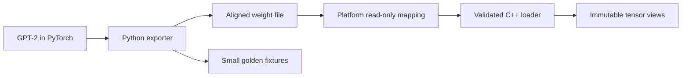

# nanoinfer

A C++20 CPU inference runtime for GPT-2 small, built one milestone at a time.
The first milestone covers weight export and validated, read-only mapped loading.
The later milestones add a reference forward pass, KV caching, hand-written GEMM
and GEMV, a thread pool, and int8 weights. The main engineering problem is keeping
the numerical contract intact while changing how data moves through the CPU.

No performance results have been collected yet. GEMM step measurements and the
roofline plot belong to M4 and M7-M8 and will link to actual runs in `results/`.



## Build and export

Requirements: Visual Studio 2022 C++ Build Tools with the Windows SDK, CMake/Ninja
and AddressSanitizer, Python 3.11 or newer, Git and `uv`. Linux requires GCC 12+
or Clang 15+, CMake 3.20+ and Ninja. Python dependencies are pinned in `uv.lock`;
GoogleTest and Google Benchmark are fetched by CMake, with benchmarks opt-in.

From the project directory in PowerShell:

```powershell
. .\scripts\dev-shell.ps1
uv sync --locked
New-Item -ItemType Directory -Force build | Out-Null
python -m pytest --basetemp=build/pytest -v
python -m python.export --tiny --output build/fixtures/tiny.bin --golden build/fixtures/golden
.\scripts\test.ps1 debug
.\scripts\test.ps1 asan
```

The development shell adds the native x64 compiler and project Python environment
to the current process's path. Caches and temporary files stay inside the project.
`scripts/test.ps1` saves complete configure, build and test logs under `results/`.

For the recorded local validation, the venv reuses an existing PyTorch
`2.11.0+cu128` installation through `--system-site-packages`; every operation runs
on CPU. Other project dependencies are installed in the venv. This avoids a
stalled wheel download on this machine. To reproduce that setup with an existing
PyTorch 2.11 installation, create the venv with `uv venv --system-site-packages`
and use `uv sync --locked --no-install-package torch`. A fresh normal `uv sync`
and CI use the official CPU wheel. Exact local versions are in
`results/m1-environment.json`.
The Windows shell accepts Hugging Face's supported cache-copy fallback and
disables its symlink-privilege advisory; system privileges are not changed.

Equivalent Linux commands:

```sh
export UV_CACHE_DIR="$PWD/.cache/uv"
export HF_HOME="$PWD/.cache/huggingface"
export TIKTOKEN_CACHE_DIR="$PWD/.cache/tiktoken"
uv sync --locked
mkdir -p build
uv run python -m pytest --basetemp=build/pytest -v
uv run python -m python.export --tiny --output build/fixtures/tiny.bin --golden build/fixtures/golden
cmake --preset debug
cmake --build --preset debug
ctest --preset debug --verbose --no-tests=error
cmake --preset asan
cmake --build --preset asan
ctest --preset asan --verbose --no-tests=error
```

Export the real pretrained model:

```powershell
python -m python.export --output models/gpt2.bin --golden golden
```

The exporter prints and saves the tensor manifest beside the model. Full weights,
download caches and generated test weights are ignored by Git. Only the small
pretrained golden set is committed. Golden fixtures are correctness data, not a
replacement for the model download.

Inspect or independently verify every exported tensor:

```powershell
.\build\debug\gpt2inspect.exe models/gpt2.bin
python tests/roundtrip.py --inspector build/debug/gpt2inspect.exe --model models/gpt2.bin --manifest models/gpt2.json
```

When `models/gpt2.bin` exists, `scripts/test.ps1` also runs the full pretrained
round-trip and saves a separate `results/m1-<preset>-gpt2.txt` log. The test binary
accepts `--seed=N`; random integration tests accept the same option.

Debug uses unoptimized code with symbols. ASan uses MSVC AddressSanitizer on
Windows and address plus undefined-behavior sanitizers on Linux. `release` uses
the compiler's release optimization; architecture-specific flags will be confined
to optimized kernel translation units when those exist, preserving scalar
portability. `tsan` is a Linux preset reserved for the threaded milestone.

## Design decisions

- Use a fixed binary table because it can be validated before interpreting any
  tensor pointer; see [the format](docs/format.md).
- Preserve Hugging Face Conv1D's `[in, out]` layout because it directly matches
  `x @ weight`, and test the orientation explicitly.
- Map f32 data because inference can share the file-backed pages without
  allocating a second weight buffer.
- Store metadata and payload CRC32 values because structural validation alone
  cannot detect changes to otherwise valid float bytes.
- Capture complete block outputs with hooks because the final Hugging Face
  `hidden_states` entry is after `ln_f`, not before it.

## Testing

Python tests check the binary layout, export constraints, weight tying, matrix
orientation and golden capture against PyTorch. C++ tests exercise mapping
ownership, Unicode paths, malformed input and tensor validation. The export
round-trip compares every shape and checksum with the independently saved Python
manifest. See [the GPT-2 contract](docs/gpt2-contract.md) for source references and
golden-state semantics.

CI builds Debug and ASan on Windows and Linux and runs formatting and Python lint
checks. CI uses a seeded tiny GPT-2 so weights are neither committed nor downloaded
for each job. C++ forward comparisons arrive in M2. Linux TSan will be required
when runtime worker threads arrive in M5.

## Limitations

M1 has no C++ forward pass, token generation, optimized kernels or quantization.
CRC32 detects accidental corruption but does not authenticate untrusted files.
The file must remain unchanged throughout the mapping's lifetime. The current
format targets little-endian IEEE-754 hosts and f32 weights.
